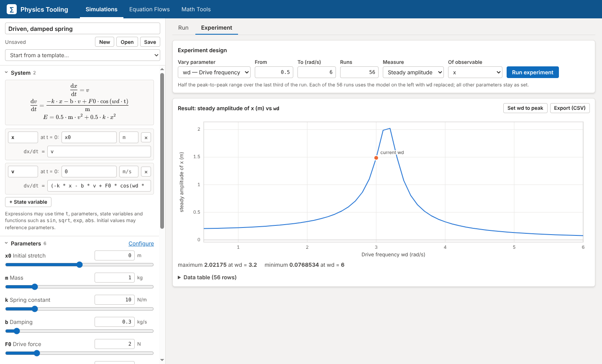
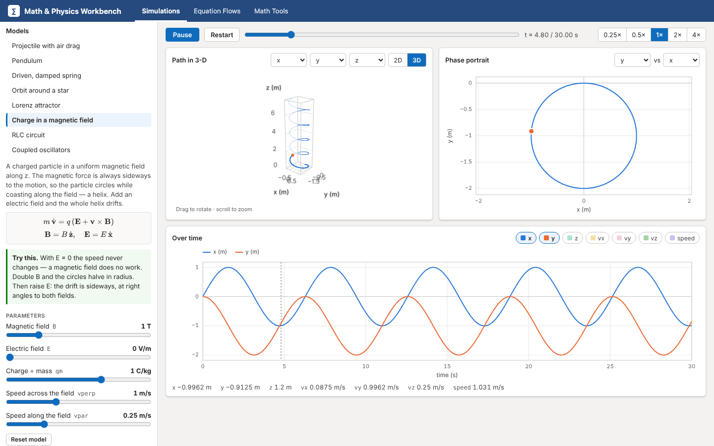
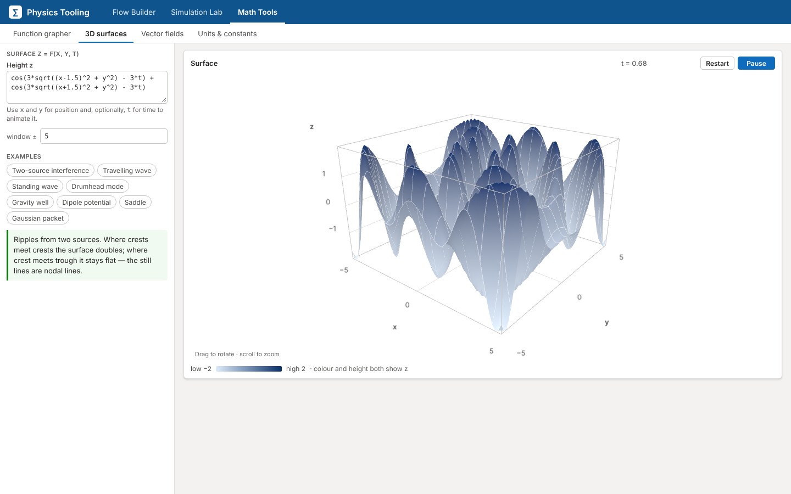
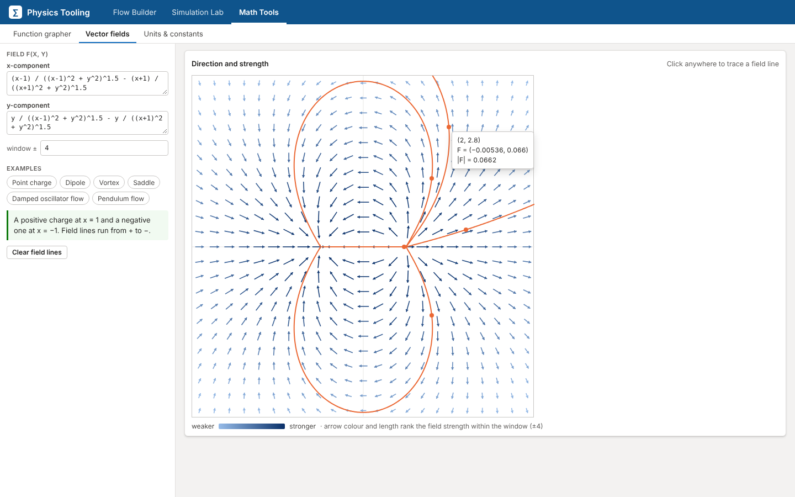

# Physics Tooling

A desktop virtual laboratory for physicists and mathematicians: define a
dynamical system, integrate it, and run numerical experiments on it — then
export the data.



## What's in it

### Simulations (the main workspace)

A simulation is a document: a set of state variables with their rates of
change, parameters, observables and solver settings. The definition stays in
view on the left and every edit re-runs immediately.

- **Define the system** — state variables with initial conditions and
  derivative expressions, named parameters with ranges and units, and
  observables (energies, invariants, anything computed from the state). The
  equations are typeset exactly as the solver will integrate them.
- **Choose the solver** — adaptive Dormand–Prince RK45 with a relative
  tolerance, fixed-step RK4, or Euler; plus a duration and an optional stop
  condition (`y < 0`). Each run reports steps, rejected steps, right-hand-side
  evaluations and wall time.
- **Run** — animated picture or rotatable 3D trajectory, phase portrait, time
  series, and a measurement table (final, min, max, time average, period for
  every quantity).
- **Compare** — hold a run as a dashed reference, change the model, and see
  both on every chart.
- **Experiment** — vary one parameter across a range, run the simulation at
  each value, and reduce each run to a measured number (final value, maximum,
  minimum, time average, RMS, steady amplitude, period, time of maximum, run
  duration). The result is a response curve with its extrema located, a data
  table, and one click to set the parameter to the peak.
- **Export** — any run or experiment as CSV at full double precision.
- **Templates** — projectile with drag, pendulum, driven damped oscillator,
  Kepler orbit, Lorenz system, charge in E and B fields, RLC circuit, coupled
  oscillators. Each is a starting point, not a fixed demo.

Simulations save as `.physsim` (plain JSON).


### Equation Flows

A node editor for composing formulas with dimensional analysis. Drag blocks,
wire outputs into inputs, and end with a Result block.

- **Blocks** — adjustable inputs, 20 physical constants, arithmetic / power /
  trig / exponential operations, a free-form **Formula** block that grows one
  input port per variable, and labelled outputs.
- **Units on every wire** — values carry SI dimensions. Adding a mass to a
  length is flagged on the block that did it; results are named automatically
  (`kg·m²/s²` becomes `J`) and can be shown in any compatible unit.
- **Equation view** — the flow is typeset symbolically, then with values
  substituted, then the result. **Copy expression** gives the plain-text
  formula for pasting into a simulation's equations; **Copy LaTeX** gives it
  for a paper.
- **Sweeps** — chart the output against one input (linear or log axes), or two
  inputs as a heat map or a rotatable 3D surface, and export the data as CSV.
- Ten worked examples. Flows save as `.physflow`.




### Math Tools
- **Function grapher** — plot several functions, with symbolic derivative,
  slope at a point, definite integral, zeros and turning points.
- **3D surfaces** — plot z = f(x, y, t) as a rotatable surface; include `t`
  and it animates (wave interference, standing waves, potential wells).
- **Vector fields** — arrow plot of any F(x, y); click to trace field lines.
- **Units & constants** — converter and a constants reference table.





## Running it

Requires Node 20 or newer.

```bash
npm install
npm run dev        # launch the desktop app with hot reload
npm start          # build, then launch the app as it will ship
npm test           # unit tests
```

### Building an installer

```bash
npm run dist       # installer for the OS you are on, written to release/
npm run dist:dir   # unpacked app only (faster; good for a quick check)
```

This produces a `.dmg` on macOS, an NSIS `.exe` installer on Windows, and an
`.AppImage` plus `.deb` on Linux. Each must be built on its own OS.

To have GitHub build all three for you, copy
[`docs/build-desktop.workflow.yml`](docs/build-desktop.workflow.yml) to
`.github/workflows/build-desktop.yml`. It then runs from the Actions tab (or
when you push a `v*` tag) and attaches the installers as artifacts.

Builds are not code-signed, so macOS and Windows will warn on first launch
until signing certificates are configured.

Keyboard shortcuts: `Ctrl/Cmd+N` new simulation, `Shift+N` new equation flow,
`O` open, `S` save, `Shift+S` save as, and `Ctrl/Cmd+1/2/3` to switch between
the three workspaces. Open and Save act on the workspace in view; opening a
file switches to the workspace it belongs to.

## Architecture

```
electron/
  main.cjs      Desktop shell: window, native menu, file dialogs, disk access
  preload.cjs   The only bridge to the UI (open/save/menu events)
src/
  desktop.ts    Typed view of that bridge
  documents.ts  New / Open / Save / export for both document kinds
  core/         Framework-free engine (unit tested, no React)
    units.ts      SI dimension vectors, unit table, constants, formatting
    qmath.ts      Arithmetic on dimensional quantities, with unit errors
    expr.ts       Small symbolic expression tree → LaTeX
    formula.ts    Formula blocks: mathjs parse tree evaluated over quantities
    graph.ts      Flow graph model, evaluator, 1-D and 2-D sweeps
    ode.ts        ODE model definition; Euler, RK4 and adaptive RK45 integrators
    measure.ts    Run measurements, parameter scans, CSV export
    numeric.ts    Derivative, Simpson integration, root and extremum finding
  components/   Plot (SVG line chart), Heatmap, Plot3D (three.js, lazy-loaded),
                KaTeX wrapper, number field
  flow/         Node editor: store, block cards, palette, inspector, model panel
  sim/          Simulations: definition panel, run view, experiment view,
                templates, animated scene
  mathtools/    Grapher, 3D surface plotter, vector field, units panel
```

The key design decision is that **the engine knows nothing about the UI**. A
flow is plain data (`Graph` = nodes + wires); `evaluate()` returns, for every
node, a value in SI units, its dimension, and a symbolic expression. The canvas
(React Flow), the equation view and the charts are all just views of that
result. That is what makes each of these additions local:

- **A new block** — one entry in `OPS` (`core/graph.ts`) or `PALETTE`
  (`flow/catalog.ts`).
- **A new unit or constant** — one line in `core/units.ts`.
- **A new example flow** — one entry in `flow/examples.ts`; the test suite
  checks every bundled example evaluates without error.
- **A new simulation template** — one object in `sim/models.ts`.
- **A new measurement** — one entry in `MEASURES` (`core/measure.ts`).
- **A new integrator** — one branch in `simulate()` (`core/ode.ts`).

**Desktop security.** The UI runs sandboxed with no Node access and a strict
Content-Security-Policy (no network, no inline script). It can only touch the
disk by asking the shell, and the shell will only write to a path the user
chose in a dialog or opened from the OS.

Stack: Electron, React 19, TypeScript, Vite, React Flow (`@xyflow/react`), three.js,
mathjs, KaTeX, zustand, Vitest.

## Known limits

- Systems are explicit first-order ODEs (`dy/dt = f(t, y)`). There is no
  implicit/stiff solver, no PDEs, no events beyond a single stop condition, and
  no stochastic terms yet.
- Experiments scan one parameter at a time and run on the UI thread in slices
  (cancellable, but a heavy model will feel slow).
- Simulation equations are plain numbers: unit labels there are annotations and
  are not checked. Dimensional checking lives in Equation Flows.

## Ideas for next steps

- Two-parameter experiments (maps) and overlaying a family of trajectories.
- Fit a model's parameters to imported experimental data (CSV).
- A stiff solver, event detection, and running experiments in a worker thread.
- Feed an equation flow directly into a simulation as a force law.
- Undo/redo, and a prompt to save when closing with unsaved edits.
- Code signing and auto-update for the installers.
