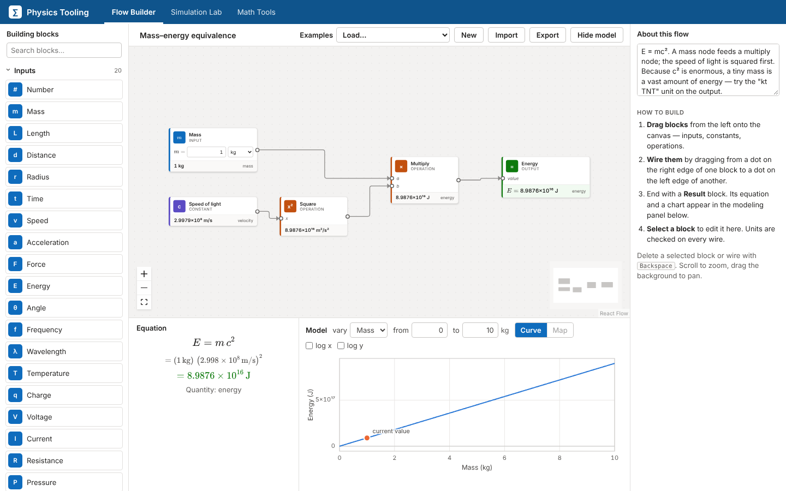
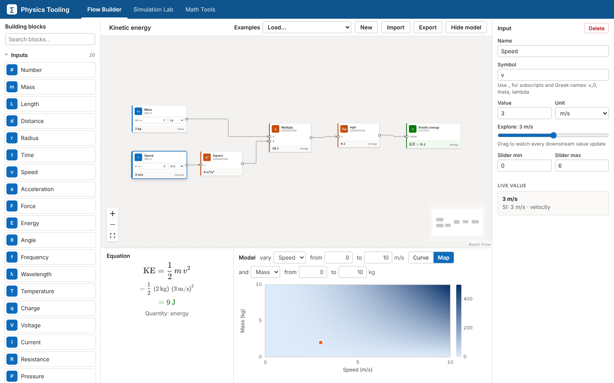
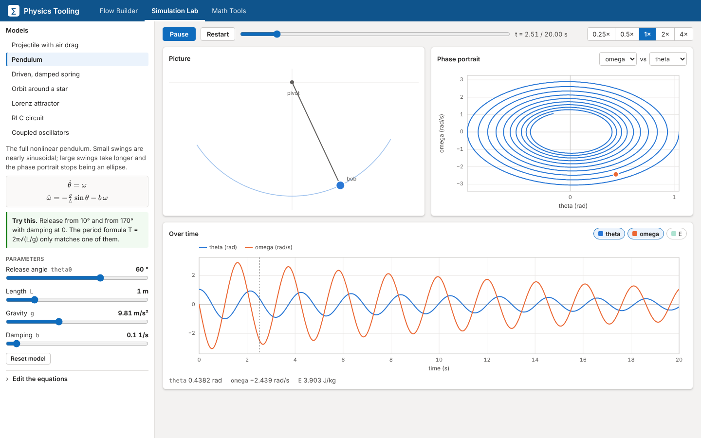

# Physics Tooling

A visual workbench for learning physics: wire quantities and operations into
equations, watch the result respond as you change inputs, and simulate systems
that evolve in time.



## What's in it

### Flow Builder
A node editor in the style of a flow designer. Drag blocks from the palette,
wire outputs into inputs, and end with a Result block.

- **Blocks** — adjustable inputs (mass, speed, angle…), 20 physical constants,
  arithmetic / power / trig / exponential operations, a free-form **Formula**
  block that grows one input port per variable, and labelled outputs.
- **Units on every wire** — values carry SI dimensions. Adding a mass to a
  length is flagged on the block that did it; results are named automatically
  (`kg·m²/s²` becomes `J`, "energy") and can be shown in any compatible unit
  (J, eV, kWh, kt TNT…).
- **Equation view** — the flow is typeset as a formula, then with the numbers
  substituted, then the result: `E = mc²` → `(1 kg)(2.998×10⁸ m/s)²` → `8.99×10¹⁶ J`.
- **Modeling panel** — sweep any input to chart the output as a curve
  (linear or log axes), or sweep two inputs at once as a heat map.
- Ten worked examples (E = mc², kinetic energy, gravitation, pendulum period,
  projectile range, Lorentz factor, de Broglie wavelength, ideal gas law,
  photon energy, escape velocity). Flows auto-save in the browser and
  import/export as JSON.



### Simulation Lab
Models defined as differential equations and integrated with 4th-order
Runge–Kutta: projectile with drag, pendulum, driven damped spring, orbit,
Lorenz attractor, RLC circuit, coupled oscillators.

Each has an animated picture, a phase portrait, time-series charts, parameter
sliders, and a "try this" prompt. Every equation, initial condition and
parameter is editable, so any model can be turned into your own.



### Math Tools
- **Function grapher** — plot several functions, with symbolic derivative,
  slope at a point, definite integral, zeros and turning points.
- **Vector fields** — arrow plot of any F(x, y); click to trace field lines.
- **Units & constants** — converter and a constants reference table.


## Running it

```bash
npm install
npm run dev        # development server
npm test           # unit tests
npm run build      # type-check and production build into dist/
```

Requires Node 20 or newer.

## Architecture

```
src/
  core/         Framework-free engine (unit tested, no React)
    units.ts      SI dimension vectors, unit table, constants, formatting
    qmath.ts      Arithmetic on dimensional quantities, with unit errors
    expr.ts       Small symbolic expression tree → LaTeX
    formula.ts    Formula blocks: mathjs parse tree evaluated over quantities
    graph.ts      Flow graph model, evaluator, 1-D and 2-D sweeps
    ode.ts        ODE model definition and RK4 integrator
    numeric.ts    Derivative, Simpson integration, root and extremum finding
  components/   Plot (SVG line chart), Heatmap, KaTeX wrapper, number field
  flow/         Node editor: store, block cards, palette, inspector, model panel
  sim/          Simulation Lab: model library, animated scene, editor
  mathtools/    Grapher, vector field, units panel
```

The key design decision is that **the engine knows nothing about the UI**. A
flow is plain data (`Graph` = nodes + wires); `evaluate()` returns, for every
node, a value in SI units, its dimension, and a symbolic expression. The canvas
(React Flow), the equation view and the charts are all just views of that
result. That is what makes each of these additions local:

- **A new block** — one entry in `OPS` (`core/graph.ts`) or `PALETTE`
  (`flow/catalog.ts`).
- **A new unit or constant** — one line in `core/units.ts`.
- **A new example flow** — one entry in `flow/examples.ts`; the test suite
  checks every bundled example evaluates without error.
- **A new simulation** — one object in `sim/models.ts`.

Stack: React 19, TypeScript, Vite, React Flow (`@xyflow/react`), mathjs,
KaTeX, zustand, Vitest.

## Ideas for next steps

- Vector quantities and vector blocks (dot, cross, magnitude).
- Feed a flow's output into a simulation as its force law.
- Sub-flows: collapse a group of blocks into one reusable block.
- Undo/redo and multiple saved flows.
- Uncertainty propagation alongside units.
