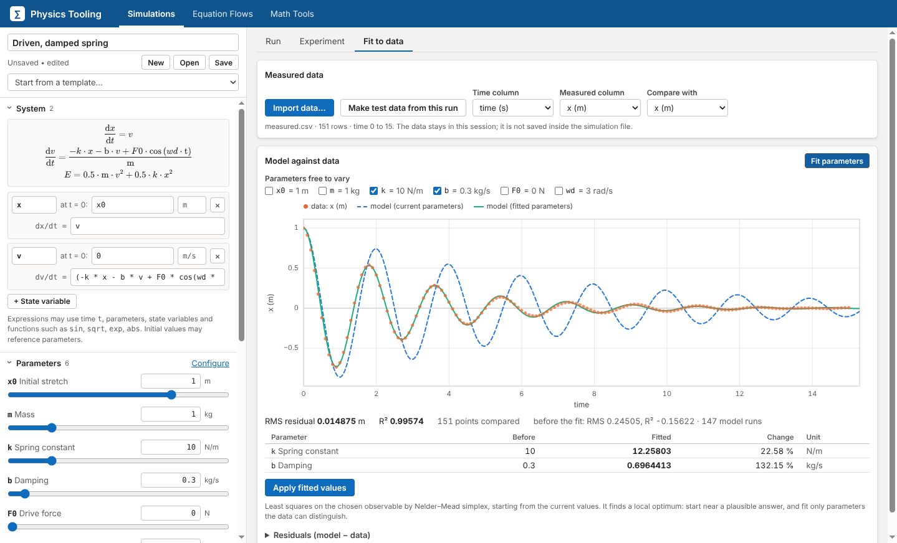
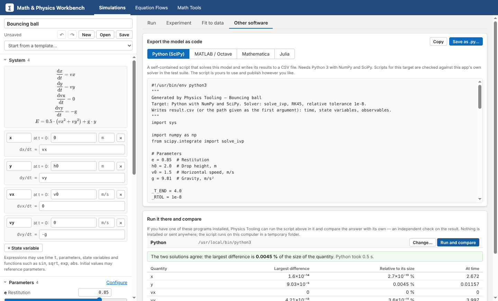
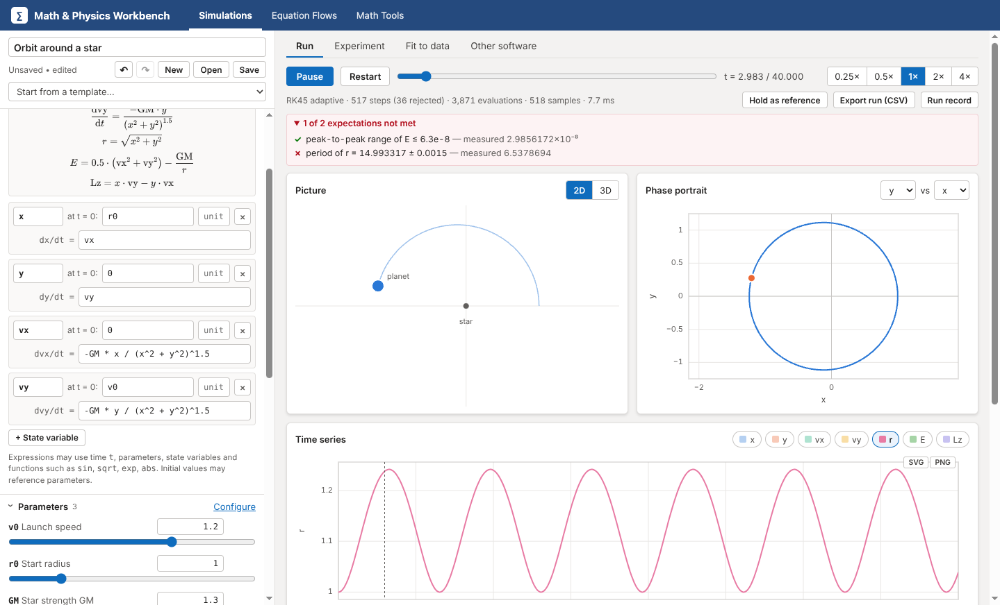
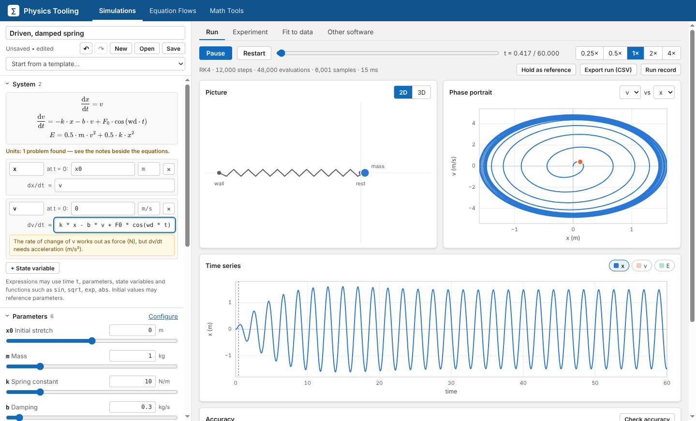
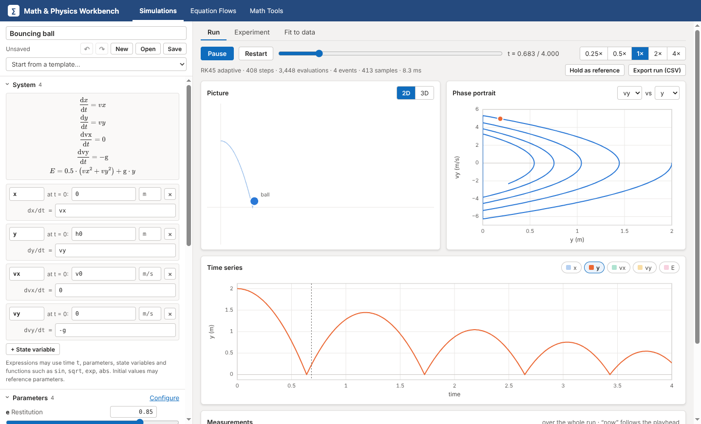
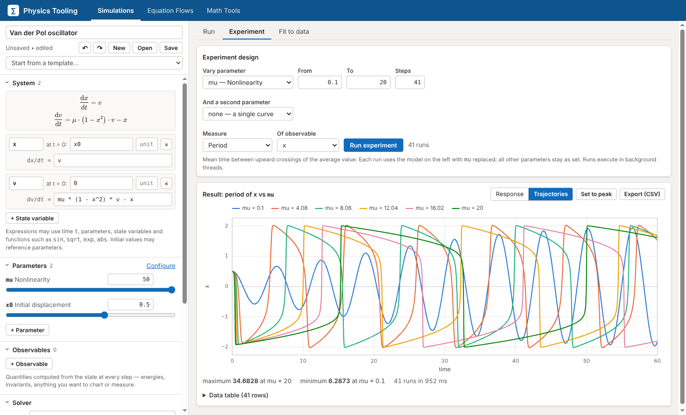
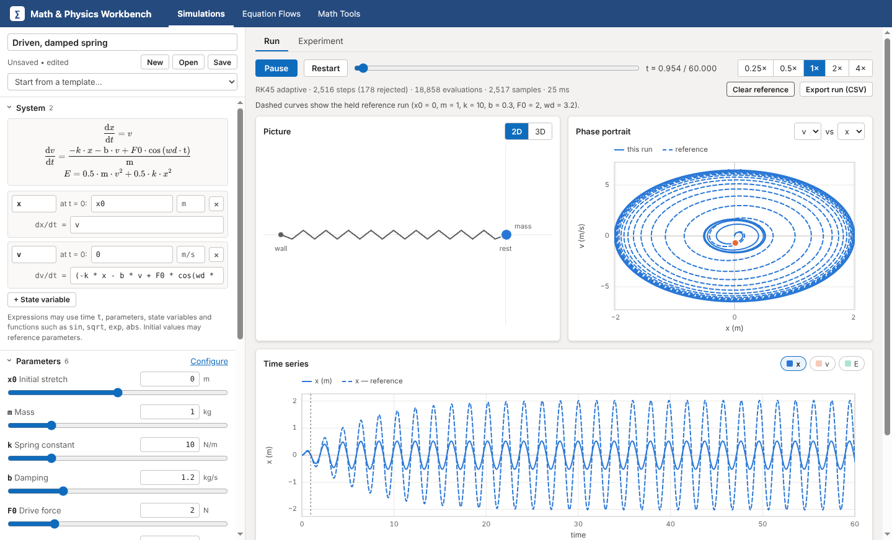
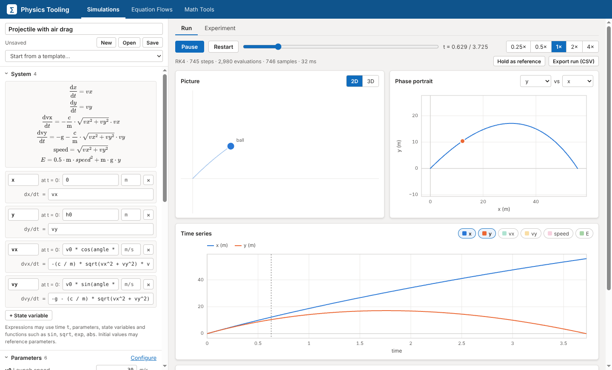

# Physics Tooling

A desktop virtual laboratory for physicists and mathematicians: define a
dynamical system, integrate it, and run numerical experiments on it — then
export the data.

It is open source and stands on its own. If you also have MATLAB, Mathematica,
Python or Julia, it can export a model as a script for any of them, run it
there, and compare the answers.


## What's in it

### Simulations (the main workspace)

A simulation is a document: a set of state variables with their rates of
change, parameters, observables and solver settings. The definition stays in
view on the left and every edit re-runs immediately.

- **Define the system** — state variables with initial conditions and
  derivative expressions, named parameters with ranges and units, and
  observables (energies, invariants, anything computed from the state). The
  equations are typeset exactly as the solver will integrate them.
- **Units are checked** — give parameters and variables units (`m/s²`, `N/m`,
  `J/(mol·K)`) and every equation is checked for dimensional consistency, with
  a note beside any that does not add up. Unlabelled quantities are simply not
  checked.
- **Events** — discrete events fire at the instant a condition turns true and
  reset state variables: bounces, kicks, switching. Several resets in one event
  are applied simultaneously from the pre-event state.
- **Choose the solver** — adaptive Dormand–Prince RK45, a Rosenbrock 2(3)
  method for stiff systems, fixed-step RK4, or Euler; plus a duration and an
  optional stop condition (`y < 0`), whose moment is located inside the step
  rather than rounded to the next one. Each run reports steps, rejected steps,
  right-hand-side evaluations and wall time.
- **Run** — animated picture or rotatable 3D trajectory (hover to read values), phase portrait, time
  series, and a measurement table (final, min, max, time average, period for
  every quantity).
- **Check accuracy** — one click re-runs the model with tighter numerics and
  with a different method and reports how far each quantity moves, so you know
  whether a result has converged before you rely on it. When a run fails, the
  message names the variable that ran away or the rate that became undefined.
- **Expectations** — statements a correct run must satisfy (a known period, a
  conserved energy), saved with the model and checked on every run. Click a
  value in the measurement table to create one.
- **Compare** — hold a run as a dashed reference, change the model, and see
  both on every chart.
- **Experiment** — vary one parameter (or two) across a range, run the
  simulation at each value, and reduce each run to a measured number (final
  value, maximum, minimum, time average, RMS, steady amplitude, period, time of
  maximum, run duration). One parameter gives a response curve; two give a
  heat map or 3D surface. A one-parameter result can also be viewed as a
  family of trajectories across the range. Extrema are located, and one click
  sets the parameters to the peak. Runs execute in parallel background threads, so the
  window stays responsive and a scan can be cancelled.
- **Uncertainty** — tick the parameters you do not know exactly and give each
  a spread (normal or uniform). They are sampled together on a Latin
  hypercube, so combinations of values are covered rather than one parameter
  at a time. The result is the distribution of a measurement (mean, standard
  deviation, 68% and 95% intervals read off the sample), a band around the
  observable over time, and Sobol sensitivity indices with intervals: how much
  of the variance each input explains on its own and including its
  interactions. The sampler is seeded, so an analysis can be repeated exactly.
- **Fit to data** — import measurements (CSV, TSV or whitespace-separated),
  pair each measured column with an observable, optionally with a column of
  error bars, and fit the parameters you choose by weighted least squares.
  Several series can be fitted together (position and velocity, say), which is
  often what separates otherwise-correlated parameters. Each parameter's range
  is surveyed before the local refinement, so oscillating data do not trap the
  fit in a wrong minimum. You get fitted values with one-sigma uncertainties,
  their correlations, χ² per degree of freedom when error bars are given, a
  warning when the data cannot separate two parameters, per-series residuals
  (with a warning when they show systematic structure), and a button to apply
  the result. *Profile the fit* then gives intervals that do not rely on the
  linear approximation. The imported data is saved in the
  simulation file.
- **Undo / redo** for every edit to a simulation or a flow.
- **Export** — any run or experiment as CSV at full double precision, with a
  header recording the app version, model, parameters and solver that produced
  it. A *run record* bundles model, result and provenance in one file. Line
  charts save as SVG or PNG, and the model's equations, parameter table and
  method description copy as LaTeX or Markdown.
- **Other software** — export the model as a script for Python (SciPy), MATLAB
  or Octave, Mathematica, or Julia; or run it in one you have installed and
  compare the result with this app's own, as an independent check. See
  [Working with other software](docs/integrations.md).
- **Templates** — projectile with drag, bouncing ball, pendulum, driven damped oscillator,
  Kepler orbit, Lorenz system, charge in E and B fields, Van der Pol
  oscillator, RLC circuit, coupled oscillators. Each is a starting point, not a fixed demo.

Simulations save as `.physsim` (plain JSON).

















### Equation Flows

A node editor for composing formulas with dimensional analysis. Drag blocks,
wire outputs into inputs, and end with a Result block.

- **Blocks** — adjustable inputs, 20 physical constants, arithmetic / power /
  trig / exponential operations, a free-form **Formula** block that grows one
  input port per variable, and labelled outputs.
- **Units on every wire** — values carry SI dimensions. Adding a mass to a
  length is flagged on the block that did it; results are named automatically
  (`kg·m²/s²` becomes `J`) and can be shown in any compatible unit.
- **Equation view** — the flow is typeset symbolically, then with values
  substituted, then the result. **Add to simulation** sends the formula to
  the open simulation as an observable, creating parameters (in SI units) for
  any inputs it does not already define; rates of change can then use it.
  **Copy expression** and **Copy LaTeX** put it on the clipboard.
- **Sweeps** — chart the output against one input (linear or log axes), or two
  inputs as a heat map or a rotatable 3D surface, and export the data as CSV.
- Ten worked examples. Flows save as `.physflow`.


### Math Tools
- **Function grapher** — plot several functions, with symbolic derivative,
  slope at a point, definite integral, zeros and turning points.
- **3D surfaces** — plot z = f(x, y, t) as a rotatable surface; include `t`
  and it animates (wave interference, standing waves, potential wells).
- **Vector fields** — arrow plot of any F(x, y); click to trace field lines.
- **Units & constants** — converter and a constants reference table.


## Running it

Requires Node 20 or newer.

```bash
npm install
npm run dev        # launch the desktop app with hot reload
npm start          # build, then launch the app as it will ship
npm test           # unit tests
```

The same commands are available through `make`: `make dev`, `make start`,
`make check` (type-check and tests together), and `make doctor`, which reports
whether the optional programs below are installed. `make` on its own lists
every target.

The tests that check exported scripts run only where the relevant program is
installed (Python with SciPy, GNU Octave) and skip themselves elsewhere.

### Building an installer

```bash
npm run dist       # installer for the OS you are on, written to release/
npm run dist:dir   # unpacked app only (faster; good for a quick check)
```

This produces a `.dmg` on macOS, an NSIS `.exe` installer on Windows, and an
`.AppImage` plus `.deb` on Linux. Each must be built on its own OS.

To have GitHub build all three for you, copy
[`docs/build-desktop.workflow.yml`](docs/build-desktop.workflow.yml) to
`.github/workflows/build-desktop.yml`. It then runs from the Actions tab (or
when you push a `v*` tag) and attaches the installers as artifacts.

### Signing the installers

Builds are unsigned by default, so macOS and Windows warn on first launch.
Signing needs certificates that only the publisher can obtain; once you have
them, no code changes are required — `electron-builder` reads them from the
environment (locally, or as repository secrets for the workflow above):

| Variable | What it is |
| --- | --- |
| `CSC_LINK`, `CSC_KEY_PASSWORD` | macOS "Developer ID Application" certificate exported as a `.p12` (file path or base64), and its password |
| `APPLE_ID`, `APPLE_APP_SPECIFIC_PASSWORD`, `APPLE_TEAM_ID` | Apple account details used to notarise the macOS build |
| `WIN_CSC_LINK`, `WIN_CSC_KEY_PASSWORD` | Windows code-signing certificate (`.pfx`) and its password |

This path has not been exercised here, since it cannot be without real
certificates.

**Automatic updates are deliberately not included.** The app is offline by
design and makes no network requests; an updater would change that, and it
also requires signed builds and somewhere to host releases. It is a product
decision rather than a missing feature.

Keyboard shortcuts: `Ctrl/Cmd+N` new simulation, `Shift+N` new equation flow,
`O` open, `S` save, `Shift+S` save as, and `Ctrl/Cmd+1/2/3` to switch between
the three workspaces. Open and Save act on the workspace in view; opening a
file switches to the workspace it belongs to.

## Architecture

```
electron/
  main.cjs      Desktop shell: window, native menu, file dialogs, disk access
  preload.cjs   The only bridge to the UI (open/save/menu events)
src/
  desktop.ts    Typed view of that bridge
  documents.ts  New / Open / Save / export for both document kinds
  history.ts    Undo / redo with coalesced edits
  integrations/ Code export for Python, MATLAB/Octave, Mathematica and Julia
  core/         Framework-free engine (unit tested, no React)
    units.ts      SI dimension vectors, unit table, constants, formatting
    qmath.ts      Arithmetic on dimensional quantities, with unit errors
    expr.ts       Small symbolic expression tree → LaTeX
    formula.ts    Formula blocks: mathjs parse tree evaluated over quantities
    graph.ts      Flow graph model, evaluator, 1-D and 2-D sweeps
    ode.ts        ODE model definition; Euler, RK4, adaptive RK45 and stiff
                  Rosenbrock integrators; event location
    fastExpr.ts   Compiles model expressions to closures for the inner loop
    measure.ts    Run measurements, parameter scans, CSV export
    sensitivity.ts  Latin hypercube sampling, uncertainty propagation, Sobol indices
    fit.ts        Data import, interpolation, Nelder–Mead, least-squares fitting
    trust.ts      Run comparison, accuracy report, expectations, provenance
    dimcheck.ts   Unit parsing and dimensional analysis of model equations
    numeric.ts    Derivative, Simpson integration, root and extremum finding
  components/   Plot (SVG line chart), Heatmap, Plot3D (three.js, lazy-loaded),
                KaTeX wrapper, number field
  flow/         Node editor: store, block cards, palette, inspector, model panel
  sim/          Simulations: definition panel; run, experiment and fit views;
                worker pool for background computation; templates
  mathtools/    Grapher, 3D surface plotter, vector field, units panel
```

The key design decision is that **the engine knows nothing about the UI**. A
flow is plain data (`Graph` = nodes + wires); `evaluate()` returns, for every
node, a value in SI units, its dimension, and a symbolic expression. The canvas
(React Flow), the equation view and the charts are all just views of that
result. That is what makes each of these additions local:

- **A new block** — one entry in `OPS` (`core/graph.ts`) or `PALETTE`
  (`flow/catalog.ts`).
- **A new unit or constant** — one line in `core/units.ts`.
- **A new example flow** — one entry in `flow/examples.ts`; the test suite
  checks every bundled example evaluates without error.
- **A new simulation template** — one object in `sim/models.ts`.
- **A new measurement** — one entry in `MEASURES` (`core/measure.ts`).
- **A new integrator** — one branch in `simulate()` (`core/ode.ts`).

**Desktop security.** The UI runs sandboxed with no Node access and a strict
Content-Security-Policy (no network, no inline script). It can only touch the
disk by asking the shell, and the shell will only write to a path the user
chose in a dialog or opened from the OS.

Stack: Electron, React 19, TypeScript, Vite, React Flow (`@xyflow/react`), three.js,
mathjs, KaTeX, zustand, Vitest.

## Scope

What the tool is built for, and where it stops:

- Systems are first-order ODEs (`dy/dt = f(t, y)`) with optional discrete
  events. Partial differential equations and stochastic terms are outside its
  scope.
- Events that accumulate without limit (a ball coming to rest through ever
  smaller bounces) stop the run with a message; there is no automatic
  "at rest" state.
- The stiff solver uses a finite-difference Jacobian and dense linear algebra,
  which suits small systems (tens of variables), not large ones.
- Fit uncertainties come from a local linearisation and assume independent
  errors.
- Unit checking in simulations is dimensional only: equations use the numbers
  as typed, so a non-SI unit is flagged rather than converted. Values sent
  from an equation flow arrive in SI units.
- Installers are unsigned until certificates are supplied (see *Signing the
  installers*).

## Licence

Physics Tooling is free software under the **GNU Affero General Public License,
version 3 or later** (see [LICENSE](LICENSE) and [NOTICE](NOTICE)). Copyright
© 2026 Pifer Labs LLC.

In plain terms:

- Anyone may use, study, change and share it, for any purpose.
- Anyone who distributes a changed version — or offers one to others as a
  hosted service — must make their source available under the same licence.
  That is what stops someone wrapping it in a closed product: a wrapper built
  on this code has to be open as well.
- It does not forbid charging money. Someone could sell a copy or a support
  contract, but only while passing on the same freedoms and the source.
- **Your work is yours.** Models, data, figures and exported scripts are not
  covered by the licence.

Coupling with proprietary tools such as MATLAB and Mathematica is unaffected:
those programs run separately, are never bundled, and remain under their own
licences.

*This is a summary, not legal advice. A licence that forbids commercial use
outright would not be open source; if that stronger restriction is what is
wanted, it is a different kind of licence and worth a lawyer's review.*

## Roadmap

[`docs/roadmap.md`](docs/roadmap.md) lists what to build next, derived from
the problems researchers report with comparable tools, with the evidence for
each and a proposed solution.
